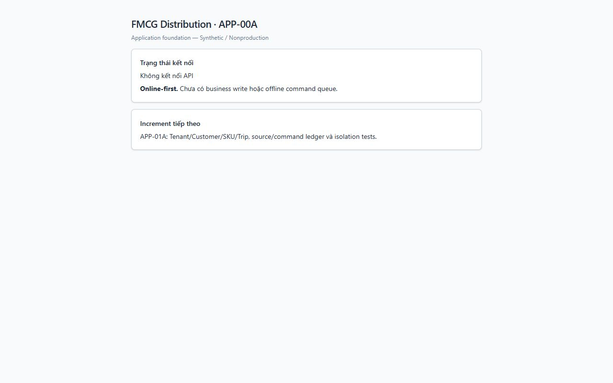
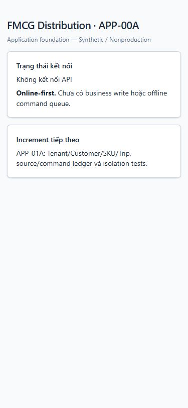
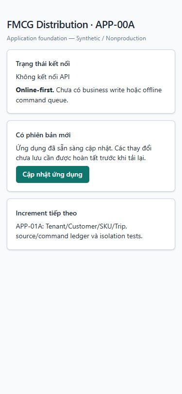
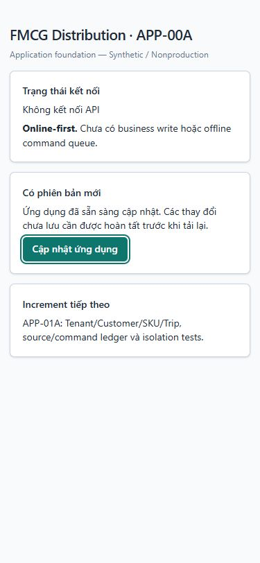
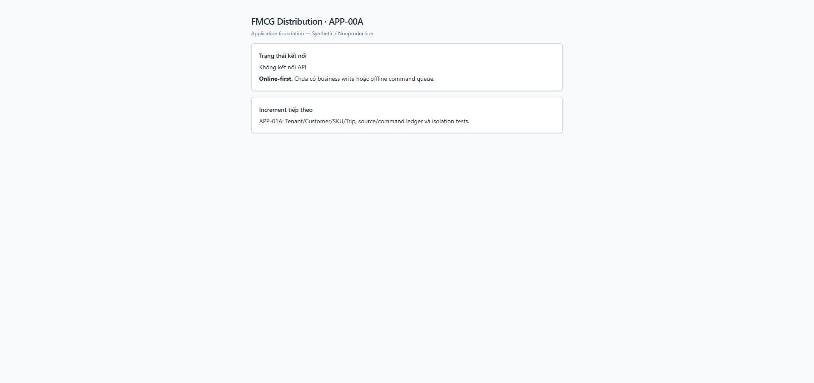

# Issue #13 — APP-00B/C Browser and PWA Acceptance Evidence

## Environment

| Field | Value |
|---|---|
| Test date | 2026-11-16 (Asia/Bangkok); evidence inventory recorded at 07:11:05 +07:00 |
| Tested commit | `9db7a81d0d2fcd3ed071082fbfabd65699ea28ad` (`main`) |
| OS | Windows 11 Home Single Language, 10.0.26300 build 26300 |
| Browser | Microsoft Edge 157.0.4341.60 |
| Frontend runtime | Node 24.22.2, npm 11.20.0 |
| Build/run | `npm ci --no-audit --no-fund`; `npm run build`; `npm run preview -- --port 4173 --strictPort` (a clean second origin used port 4174 for the final PWA lifecycle) |
| Scope | Synthetic/nonproduction APP-00B/C only |

The first shell attempt inherited Node 26.13.1 and emitted `EBADENGINE`; it was discarded as evidence. Install and build were repeated using the explicit Node 24.22.2 executable with npm 11.20.0 and exited 0.

## 100% visual acceptance

Edge zoom was reset with `Ctrl+0`. Both captured viewports reported `devicePixelRatio = 1`, no relevant console warnings/errors, no framework overlay, and meaningful APP-00A content. `Không kết nối API` is expected when Vite preview runs without the API and is not a UI/PWA failure.

| Viewport | `innerWidth × innerHeight` | `clientWidth` | `scrollWidth` | Result |
|---|---:|---:|---:|---|
| Desktop | 1280 × 800 | 1280 | 1280 | PASS — compact layout, spacing and cards visible; no horizontal overflow |
| Narrow | 375 × 812 | 375 | 375 | PASS — content wraps without clipping; no horizontal overflow |

## Actual Edge PWA V1 → V2 lifecycle

1. Opened the production V1 build on `http://127.0.0.1:4174/`, allowed the generated service worker to activate, and reloaded once so V1 controlled the page.
2. Kept the V1 tab open. Created a temporary, ignored V2 deployment by changing only generated `dist/index.html` to the title marker `FMCG DMS — APP-00A [Issue13 V2]` and changing the generated service-worker precache revision. No tracked source or business file was used as test state.
3. Triggered the same-tab update check. The visible **Có phiên bản mới** prompt appeared while the page title remained `FMCG DMS — APP-00A` for at least three seconds: no silent reload.
4. Pressed Tab. The active element was the **Cập nhật ứng dụng** button and computed focus styling was `outline-style: solid`, `outline-width: 2px`, color `rgb(15, 118, 110)`.
5. Activated the button through the real Edge tab. The prompt disappeared and the page reloaded to title `FMCG DMS — APP-00A [Issue13 V2]`; console warning/error collection remained empty.

## Reproducibility and exploratory observation

The repository's Playwright test keeps the exact same-tab `registration.update()` path and verifies the real service-worker state, V1 marker preservation, prompt, focus, explicit click, controller replacement and V2 reload. On the unchanged production code, an additional two-client characterization was run: a second page discovered V2 while page 1 remained open; page 1 prompted and successfully activated/reloaded after consent (`1/1 PASS`). Because that characterization passed before any implementation change, no unsupported production fix was introduced.

One earlier Edge-control attempt did not navigate after the automation layer clicked a prompt produced by a second tab. It did not reproduce in the real Playwright two-client characterization or in the final same-tab Edge lifecycle above, so it is recorded as an automation-path anomaly rather than an application failure.

## Acceptance boundary

- 125% browser zoom / Windows scaling is **EXCEPTION_ACCEPTED / NOT_TESTED** under `OWN-APP00B-13-02`; it is not a PASS and is not deferred roadmap work.
- This evidence does not authorize offline business writes, EV/P0, production, pilot or tenant go-live.
- The repository Owner explicitly accepted this evidence on 2026-11-16 under [OWN-APP00B-13-03](../../../decisions/owner-app00b-13-03-browser-acceptance.md). Issue #13 is authorized to close after the decision record reaches `main` with green final-HEAD CI; the APP-00B browser prerequisite no longer blocks APP-01A.
