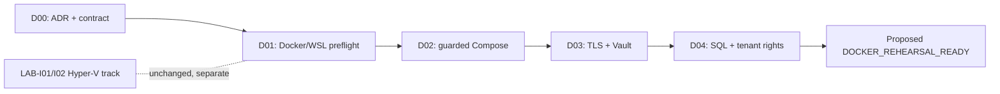

# APP-02B LAB-D00–D04 — Windows Docker Desktop / WSL2 rehearsal roadmap

**Status (2026-11-21):** D00 architecture `ROADMAP_PROPOSED`, D01 `SOURCE_MERGED / HOST_BLOCKED`. The Owner requested this roadmap for a Windows laptop with Docker/WSL2 and insufficient capacity for separate Hyper-V APP/DATA/VAULT VMs. The [32-increment Windows VM roadmap](app-02b-local-preprod-acceptance.md) and its separate physical acceptance gates remain in force. D02–D04 require separate Owner authorization.

**Decision/ADR:** [Docker/WSL2 proposal](../decisions/proposed-app02b-docker-wsl2-rehearsal-2026-11-21.md) · **Codex handoff:** [LAB-D handoff](app-02b-local-docker-wsl2/codex-handoff.md) · **Existing architecture:** [APP-02B local lab design](app-02b-local-preprod/design.md) · **VM platform contract:** [LAB-I01/I02](app-02b-local-preprod/01-platform-and-recovery.md) · **Physical oracle:** [B.9](app-02b9-independent-preprod-oracle.md).

**Reviewed baseline:** PR [#93](https://github.com/chung6a8m/fmcg-distribution-dotnet/pull/93) merged as `4bb30c342b50d73af7f66f509202d275af6d4809` on 2026-11-21. Re-evaluate later changes on `main` before implementation; current I01 source and the original B.9 oracle remain untouched.

## 1. Intent, constraints and non-goals

**Intent:** use the user's real Windows laptop as an operator workstation for *bounded local engineering rehearsal* with Linux containers under Docker Desktop's WSL2 backend. Exercise the source/build path, API/Worker foundation, SQL tenant separation, scoped Vault credentials, network denial and restart/persistence with repeatable evidence. No separate Hyper-V VMs are required for this track.

**Non-goals:** do not establish independent VMs, physical PREPROD, off-host disaster recovery, production-grade security isolation or original B.1/B.9 human approval. Do not open APP-02C/D/E runtime, real money posting, production/Pilot/Go-Live or grant real business command authority. Docker containers on one daemon/WSL2 host share a kernel/privilege/storage/failure domain. `DOCKER_REHEARSAL_READY` is a proposed **new engineering-only milestone**, not `LOCAL_LAB_READY` or `PREPROD_FOUNDATION_VERIFIED`.

Preserve `business/`, `business.lock.json`, `tools/app02b9/expected-v1.json`, the B.9 validator, current source/synthetic guards, RUNTIME denial semantics, PR #93 source/CI history, and the original five gates G-B01..05 with 30 cases plus RUNTIME-01/02. A GitHub issue's closed state cannot substitute for physical acceptance. Record #53 as GitHub CLOSED (PR #74 still OPEN/DRAFT and physical B53 NOT_VERIFIED), #68/#75 as OPEN and #59 by its scoped policy; never infer fixes from issue status.

**Separate evidence axes (never collapse):**

| Axis | Possible evidence | Claim forbidden without separate proof |
|---|---|---|
| Source/CI | Reviewed SHA, tests, CI runs on exact HEAD, image digest | Laptop measurement or deployment |
| Host preflight | Read-only Docker/WSL2 report on the actual laptop | Full Hyper-V I01 readiness |
| Authorized local execution | Enrolled scope, actual Compose/SQL/Vault/network observations | Independent host/role custody or external-origin observation |
| Physical B.1/B.9 | Original approved trust roots, observer/Security/DBA, fault/restore witnesses | Inherited from Docker rehearsal or solo AI review |

### Proposed service topology (not VM trust domains)

```text
Windows operator laptop (approved local evidence folder outside Git)
  Docker Desktop / WSL2 Linux-container engine [one shared host/failure domain]
    edge (loopback HTTPS only when authorized)
      -> API (FOUNDATION_ONLY / NO_GO)       APP service role
      -> Worker (non-dispatching foundation) APP service role
    SQL Server container + separate A/B and Control Plane databases  DATA service role
    persistent Vault server + audit + TLS                      VAULT service role
    operator test/observer process (Windows, or enrolled private test peer)
  separate restricted evidence files + operator-held external copies where provided
```

Use explicit Compose networks and service membership; the existing [B.2 Compose](../../deploy/preprod/compose.yaml) currently leaves SQL/Vault **outside** its APP stack and keeps API/Worker `FOUNDATION_ONLY / NO_GO`. Do not alter its production/PREPROD meaning to absorb this rehearsal. Introduce a dedicated, explicitly named local Compose project and overlays in later increments. No `ports` for SQL/Vault/Worker/API management, no `network_mode: host`, no `privileged`, no Docker socket in containers, no wildcard host bindings; a permitted edge may bind `127.0.0.1` only after a port ownership check. Compose `internal` networks and UFW rules **alone are not verified egress/ingress policy**; test actual connectivity from each claimed vantage.

SQL's Linux container is supported only for matching Linux x86-64 Intel/AMD host/engine architecture; don't assume support on ARM64/QEMU/translation. Pin published image digests and verify the actual Docker context and license before creating data volumes. Plan memory/disk against actual WSL2/Docker limits (not the I01 VM 32/64 GiB planning profile).

## 2. Register and dependencies — one increment / one PR

These five proposed rows are **separate from the existing 32-row LAB-E/I/S/O register**. Creating this roadmap does not increment that register's SOURCE_MERGED count or make its M1 milestone complete.

| ID | Proposed PR scope and dependency | Deliverable / exit gate | Current state |
|---|---|---|---|
| **LAB-D00** | Docs-only architecture proposal, contract boundaries and this roadmap; no source dependency beyond PR #93 baseline | Reviewed ADR + D01–D04 specs + Codex handoff, exact links and acceptance labels | `DOCS_REVIEW / PROPOSED` |
| **LAB-D01** | Read-only Docker/WSL2 host preflight after D00 proposal merge and direct D01 Owner instruction | Versioned redacted report, capability + provenance inventory, safe operator disposition | `SOURCE_MERGED / HOST_BLOCKED` |
| **LAB-D02** | Guarded Compose plan/apply, networks, storage, negative probes; source dependency D01 | Scoped project plan/ownership, idempotent infra-only Apply, no business admission | `PLANNED / NOT_AUTHORIZED` |
| **LAB-D03** | Trusted TLS, durable Vault Raft, role credential lifecycle; D02 source and enrolled live sandbox | Real Vault 403/audit, persistence, fail-closed trust & token rotation | `PLANNED / NOT_AUTHORIZED` |
| **LAB-D04** | Supported SQL instance + A/B tenant identities and permission probes; D02/D03 source, B3–B5 and current authority prerequisites | Same-instance DB layout, migrations/readback, denial witnesses and local reconciliation | `PLANNED / NOT_AUTHORIZED` |

Source-only work may be reviewed independently while laptop access/host approval remains blocked; in that event report `SOURCE_REVIEW` and `HOST_NOT_RUN/BLOCKED`, never `DOCKER_REHEARSAL_READY`. D04 may **design** SQL migrations/probes while D03 live Vault is blocked; D04 **Apply** must consume actual enrolled D03 credentials/trust.



## 3. LAB-D00 — Architecture, authority and roadmap

**PR boundary:** documentation only. Paths: [ADR](../decisions/proposed-app02b-docker-wsl2-rehearsal-2026-11-21.md), this roadmap, [handoff](app-02b-local-docker-wsl2/codex-handoff.md), plus navigation links in README/master roadmap/AGENTS. Do not modify I01/I02 source, status, schema or VM acceptance criteria.

**Contract decisions to record (not silently approve):**
- `DOCKER_DESKTOP_WSL2` as proposed execution topology and one shared failure domain.
- Evidence tier `LOCAL_OPERATOR_LAB` and `SOLO_OWNER_SELF_ATTESTED` only when the actual local run supports those statements; original `originalGateStatus=NOT_VERIFIED`.
- Proposed `DOCKER_REHEARSAL_READY` as a **nonphysical** milestone. Until separately authorized and measured, use `PROPOSED/NOT_VERIFIED`.
- D01 and D02 proposed versioned input/output names, disjoint from `APP02B-LAB-WINDOWS-PLAN-V1`, `APP02B-LAB-WINDOWS-PREFLIGHT-V1` and LAB-E05 protected `APP02B-LAB-ENVIRONMENT-V1`/`APP02B-LAB-ADMISSION-V1`.
- A concrete operator-approved Docker context, host/resources, project nonce/ownership, volumes, images, approved bindings, trust and retention is required before live Apply.

**Review/exit:** independent docs review, relative link/anchor checks, preserve 32-row register and B.9 remaining physical obligations verbatim; final HEAD CI as applicable. Merge only after a separate Owner review/merge instruction. A merged docs PR is not implementation authorization for D01–D04.

## 4. LAB-D01 — Docker/WSL2 preflight and image provenance

**Source review:** `feat/app02b-lab-d01-docker-preflight` starts from D00 merge `be961ba7f71eead5360fe8cc31c22a0a6e989818` via [PR #94](https://github.com/chung6a8m/fmcg-distribution-dotnet/pull/94). The Owner's direct LAB-D01 implementation instruction of 2026-11-21 authorizes this source increment. The checked-out source SHA and plan SHA-256 are recorded in each valid attempt.

**Implemented interfaces:**
- `scripts/lab/Test-DockerWslPrerequisites.ps1 -ConfigFile <path> -OutputDirectory <new-protected-directory>` — **read-only**; exit 0 only when required conditions measured PASS, exit 1 input/collection failure, exit 2 required condition BLOCKED/UNKNOWN.
- `tools/app02b_lab/docker_preflight.py` plus `tools/app02b_lab/schemas/lab-docker-host-*-v1.json`. D01 uses the independent `APP02B-LAB-DOCKER-HOST-PLAN-V1` and `APP02B-LAB-DOCKER-HOST-PREFLIGHT-V1` contracts and shared strict parsing and Windows path safeguards.
- [Operator guide](../../deploy/lab/docker-wsl2/README.md), example plan, toolchain floors, and `tests/app02b_lab/test_docker_preflight.py`.
- Outputs `docker-preflight.json`, `docker-preflight.md` and `SHA256SUMS` under operator-protected outside-repo storage.

**Required observations:** exact Windows build/architecture; WSL version and distro mode; running Docker Desktop/Engine, selected `docker context`, daemon endpoint/host identity (not a remote/unexpected engine), Linux container OS/arch, Compose/plugin versions, storage backend and Docker root; resource ceilings/free RAM/disk/WSL2 allocation; existing Compose projects, container networks, volumes, binds and host/loopback port collisions; local DNS/clock; image registry/digest/signature or trusted publisher provenance; CLI availability and redaction.

**Negative tests:** absent daemon, Windows-container backend, WSL1, remote context, ARM/emulation SQL, missing memory/storage, unknown data root, preoccupied ports, unsupported image pin, polluted `DOCKER_HOST`, secret-leaking input, symlink/reparse and Git evidence path. A synthetic CI runner is not the user's laptop. **Exit:** one exact-source redacted report with no required UNKNOWN; host restrictions remain explicit even if Docker works. No Docker pulls, `compose up`, installs, settings changes or VM mutations at D01.

**Source and CI:** [PR #95](https://github.com/chung6a8m/fmcg-distribution-dotnet/pull/95) merged reviewed source `8e74a3f2a1cd3b9c1b4056008db2538407000ffd` at `9486b30326e16093620ef37de39bedbc90ffd229`. GitHub lists 24/24 successful PR jobs. The exact source passed [LAB-E05 Windows/Linux, attempt 1](https://github.com/chung6a8m/fmcg-distribution-dotnet/actions/runs/44901699348/attempts/1) and the [synthetic B.9 dispatch, attempt 1](https://github.com/chung6a8m/fmcg-distribution-dotnet/actions/runs/44901696304/attempts/1).

**Operator laptop:** On 2026-11-21 at 12:25:24 UTC, `d01-attempt-01` ran on clean merge `9486b30326e16093620ef37de39bedbc90ffd229` and returned `BLOCKED` (exit 2), with `authorization=NOT_EVALUATED`. The first-run plan used zero identity pins for discovery, publisher metadata receipts for four `linux/amd64` pins, and the example resource floors and reservations. Plan SHA-256 `6886ae9b5c524cfbad76fb7a043c39bf25f93fadaab24741b9f6fb11d2aec791`. The JSON report SHA-256 is `4ab37c85a9eec239c0a11a891e7625131ab8c9aca565b3fdacd482d1e858b509`. The report, Markdown and verified checksums are under protected local custody outside Git.

The collector returned `DAEMON_UNAVAILABLE` before the Docker CLI probe because two distinct executable paths were reported for running Docker Desktop processes. A separate signature-checked read-only probe reached local `desktop-linux`, with an x64 Linux engine, WSL2, 7,796 MiB daemon RAM and 20 visible CPUs. The official report measured 3,677 MiB free Windows RAM against the 4,096 MiB example floor. Two distinct storage setting paths prevented selection of a recognized VHD. A separate cache read found no match for the four exact plan pins. Linux filesystem headroom remains `NOT_MEASURED`.

**D02 disposition:** The D01 source dependency is met. D02 source remains `NOT_AUTHORIZED` pending a separate Owner instruction. Live Apply remains `APPLY_BLOCKED` pending a fresh D01 `READY` on reviewed source with intended identities pinned, verified resource headroom, matching cached images and an exact plan with scoped operator enrollment and authorization. The SQL Developer license choice remains for operator confirmation. Original physical acceptance is `NOT_VERIFIED`. APP-02B retains `FOUNDATION_ONLY / NO_GO`.

**Native tool provenance:** Use OS-known Windows roots and verify Authenticode for Docker Desktop, CLI plugins and Windows system tools before invoking those probes. Reject conflicting shell roots and user-controlled plugin search paths. The implementation PR retains the source review and Windows regression receipts.

## 5. LAB-D02 — Guarded Compose plan/apply, networks and storage

**Proposed branch:** `feat/app02b-lab-d02-compose-boundaries`. **Source dependency:** reviewed/merged D01; live prerequisite: D01 host result on the **actual** laptop and separately authorized exact target/plan. Do not attempt to satisfy LAB-I01 Hyper-V readiness.

**Owned paths/interfaces (proposed):** `deploy/lab/docker-wsl2/compose.yaml` (and separately reviewed overlays/templates), `scripts/lab/New-DockerRehearsal.ps1`, `scripts/lab/Test-DockerRehearsalNetwork.ps1`, `deploy/lab/docker-wsl2/network-policy.md`, `tests/app02b_lab/test_docker_compose.py` and focused shell/PowerShell tests.

- `-Plan -ConfigFile ... -OutputDirectory ...` is mutation-free; produces a source/daemon/context/config/image/volume/network/port/nonce-bound exact change set and digest, plus existing-resource inventory.
- `-Apply -EnrollmentFile ...` is opt-in and **fail-closed** on absent/mismatched preflight, target context/daemon, image digests, enrollment, ACL, target ownership, resource budget, port/network collision or changed plan. Do not self-issue approval.
- Enforce project-specific Compose name and nonce/ownership labels. Re-apply converges without replacing or erasing existing volumes; foreign or unlabeled resources are never adopted. Cleanup only exact enrolled resources after separate explicit operation; prohibit `docker compose down -v`, `docker system prune` and shared-volume deletion by default.
- Stage service topology and persistent directory/volumes for APP/DATA/VAULT without pretending SQL/Vault are provisioned in D02. Reuse B.2 API/Worker foundation behavior and `NO_GO`; missing later D03/D04 services remain `BLOCKED`, not test-success stubs.
- Default exposure none; approved edge may bind Windows `127.0.0.1` only after probing. Exclude docker.sock, privileged/host network, plaintext secrets, broad bind mounts and mutable image tags. Network policy for backend/mgmt and actual Docker Desktop/WSL host paths is mandatory.

**Verification matrix:** dry-run no mutation, first apply on nonce-owned fixture, second apply idempotent, foreign project/volume, stale plan/context/host, port overlap, network conflicts, interrupted apply, cleanup denial, and data persistence over container recreation. Network probes use actual `WINDOWS_HOST`, `DOCKER_PRIVATE_PEER` and `OUTSIDE_APP_BRIDGE` vantage labels; no `EXTERNAL_INTERNET` claim without an actual external tester. Check positive permitted edge and negative SQL/Vault/Worker/API direct sockets, forwarded headers, unintended published ports and shared-host bypass. Container network membership is **not** proof of external firewall isolation.

**Exit:** source tests and exact-HEAD CI PASS; local Apply only with prior approved enrollment and actual witnesses. No claim of physical VM isolation or production readiness.

## 6. LAB-D03 — Local trusted TLS, persistent Vault and secret lifecycle

**Proposed branch:** `feat/app02b-lab-d03-vault-tls`. **Dependencies:** D02 source; D02 enrolled network/volume boundaries and an approved operator-owned trust/custody arrangement for live testing.

**Owned paths (proposed):** `deploy/lab/docker-wsl2/vault/`, `scripts/lab/Initialize-DockerLabVault.ps1`, `scripts/lab/Test-DockerLabVault.ps1`, dedicated scoped token-rotation helper and regression tests. Prefer existing B.2 Vault policies (`deploy/preprod/vault-policy-api.hcl`, `vault-policy-worker.hcl`) where the actual Vault paths/roles match; do not broaden grants.

- Normal Vault server mode, persistent Raft storage and audit sink **outside any SQL/tenant restore path**; no dev/in-memory mode, one-share ephemeral CI unseal or implicit root tokens as lab verification.
- TLS chain and hostname verified for edge/Vault; CA signing keys and unseal/recovery material remain in protected operator custody and never enter APP containers or evidence bundles.
- Separate API/Worker/operator role-scoped revocable tokens. Probe real 200/403 and Vault audit events, wrong role/path, revoked/expired token, untrusted cert, missing audit sink, restart and durable Raft recovery.
- Token issuance/bootstrap and fault windows require actual operator approval. Do not auto-grant access on missing credentials or fall back to HTTP/`-k`/`TrustServerCertificate=true`.
- Record that one Windows/Docker host and one owner do not provide independent secret custody, off-host restore or HA. If audited off-host copy/key custody is absent, keep corresponding recovery/physical claims BLOCKED.

**Exit:** verified local TLS/403/audit/persistence evidence with source/image/volume references; still `FOUNDATION_ONLY / NO_GO` and not original B.2 runtime acceptance.

## 7. LAB-D04 — Real SQL container, A/B databases and privilege probes

**Proposed branch:** `feat/app02b-lab-d04-sql-tenants`. **Dependencies:** D02/D03 sources and live protected trust/credentials; reuse reviewed B3 Identity, B4 Tenant Registry, B5 revocation fence and I05 lifecycle scope where available. Issue #53 is CLOSED on GitHub but PR #74 remains OPEN/DRAFT; current B53 source/integration and physical revocation/PITR authorization remain independent prerequisites for any B53 operation. No cherry-pick or silent grant.

**Owned paths (proposed):** `deploy/lab/docker-wsl2/sql/`, `scripts/lab/Install-DockerLabSql.ps1`, `scripts/lab/Test-DockerLabSql.ps1`, a bounded redacted SQL privilege probe and focused tests. Use existing migration/tenant tooling and `Microsoft.Data.SqlClient` where appropriate; do not create a competing tenant lifecycle engine.

- Pin an officially supported **Linux x86-64** SQL image by immutable digest, version, edition/CU and license/usage mode; reject ARM emulation, unsupported architecture, unreviewed tags or SQL instance mismatches. Scope to synthetic local data.
- Use persistent enrolled SQL data and distinct backup target; *never* restore/overwrite foreign DB/volume. Require stable DB name allowlist and run nonce/ownership before create/backup/restore.
- Keep B3/B4/B5 and A/B databases needed for atomic cross-DB effects on **one SQL instance**. Current authorization fence is not reset with tenant PITR; prohibit whole-DATA-container/volume rewind as accepted restore.
- TLS encryption with CA/hostname validation, Vault-provided role-specific credentials in memory. No SQL password in argv, `.env`, logs or reports; no `sqlcmd -P`, `TrustServerCertificate`, shared sysadmin/db_owner to satisfy permission checks.
- Exercise approved tenant A/B provisioning/readback, identity and role separation, cross-tenant denied queries, observer cannot DML, API cannot DDL, stale/revoked authority denied, migration idempotency and no peer fingerprint drift. Measure actual SQL effects; SQL row counts and integrity witnesses come from independent bounded read operations, not only API success flags.
- If tenant lifecycle, B53 permit, durable APP02 journal, independent fault/restore or operator admission is not implemented/authorized, keep those tests `NOT_RUN/BLOCKED` rather than inventing PASS.

**Exit:** traceable local SQL permission evidence and source/CI, not completed original `G-B01..05`, RPO/RTO, two-tenant production admission or B.9 physical approval.

## 8. Proposed milestones and acceptance labels

| Milestone | Exact condition | Max permissible claim |
|---|---|---|
| D0 — roadmap review | This docs PR reviewed, accepted and merged | `DOCKER_REHEARSAL_ROADMAP_REVIEWED` (documents only) |
| D1 — measured host | Actual Windows Docker/WSL2 preflight, no required blocker; operator-approved resources | `DOCKER_HOST_PREFLIGHT_OBSERVED` |
| D2 — guarded foundation | D02 source/CI, separately authorized local Apply, idempotency and negative probes | `DOCKER_FOUNDATION_OBSERVED` (not VM readiness) |
| D3 — trust layer | D03 TLS/Vault persistence/denials with protected actual evidence | `DOCKER_VAULT_OBSERVED` |
| D4 — SQL and tenants | D04 real supported SQL, B3/B4/B5 bounded tenancy and rights, negative probes, exact-source CI; no missing required D-track check | Proposed `DOCKER_REHEARSAL_READY` after Owner adopts that nonphysical label |
| Existing VM M1 / physical B.9 | Separate VM/VPS host and original gate evidence from the canonical 32-increment roadmap | **Never inferred from D00–D04** |

`SOURCE_REVIEW` means implemented PR open; `SOURCE_MERGED` requires an actual merge. `HOST_OBSERVED`/`LAB_EXECUTED` need current original evidence. D-track failures remain FAIL/BLOCKED/NOT_RUN with reasons. No source-only PR may update B.9 physical gate to PASS.

## 9. Verification, evidence and closeout protocol

For **every** D increment:

1. Begin on current `main`, identify dependency merge SHAs, frozen source/commit, toolchain lock and exact scope. Separate source development from privileged live execution. Never alter the frozen B.9 expected fixture.
2. Use independent technical review (separate Codex context or reviewer); classify findings, resolve blocking ones and run meaningful negative tests. AI review is not independent human Security/DBA approval.
3. Run focused Python/PowerShell/Compose tests and applicable .NET/APP-00A/B.2/E05/B.9 tests; validate the retained GitHub workflows on the **final PR HEAD**. A `git diff --check` and docs links check are additionally mandatory for D00.
4. Protected evidence lives outside every Git worktree. Record SHA, config/image digests, Docker context/daemon identity, operation nonce, environment class, observed target, UTC, test IDs, failed attempts, exit/status, data redaction and actual vantage. A Docker stdout message alone is not an independent witness. Never upload tokens/private keys/raw host identifiers.
5. Run/attempt history is append-only; a green retry does not erase a prior FAIL. Publish only redacted summaries in PR, with protected raw evidence under operator custody and a separately retained checkpoint if E05's integrity model is used.
6. Keep a canonical section/row per increment and PR metadata for final source H, source checks, later merge commit M, approved operation and actual host results. Follow [existing closeout policy](app-02b-local-preprod/codex-handoff.md#51-increment-closeout); no recursive docs PRs acknowledging earlier docs merges.
7. All source changes require their **own** D01/D02/D03/D04 PR. Report `NOT_AUTHORIZED` if Owner has approved roadmap review only. Do not auto-merge, auto-deploy or close original #53/#56/#75 due to local PASS.

## 10. Risks and handoff

| Risk | Required guard / owning increment |
|---|---|
| Acting on unexpected Docker daemon/context | D01 host+context identity, D02 atomic revalidation before Apply |
| WSL2/host resource contention | D01 measured budget; D02 bounded resource/volume and no global daemon cleanup |
| Wrong port/network/false external origin | D02 loopback default, network/negative probes with actual vantage |
| Shared-host loss of SQL/Vault/audit | D02–D04 persistent distinct storage; explicitly record shared failure domain and missing off-host copy |
| Compromised token/CA or untrusted TLS | D03 protected trust and role-scoped revocation; D04 SQL encrypted verified transport |
| Cross-tenant/rollback permission drift | D04 same-instance current authority, independent SQL readback; #53 remains a separate prerequisite |
| Physical evidence mislabelled as approved | D00 decision boundary, all D PRs and original B.9 unchanged |

**Next executable step:** review the dedicated LAB-D01 source PR and collect the read-only host receipt on the intended laptop with the protected operator plan. D02 implementation and Apply retain their separate authorization gates.
