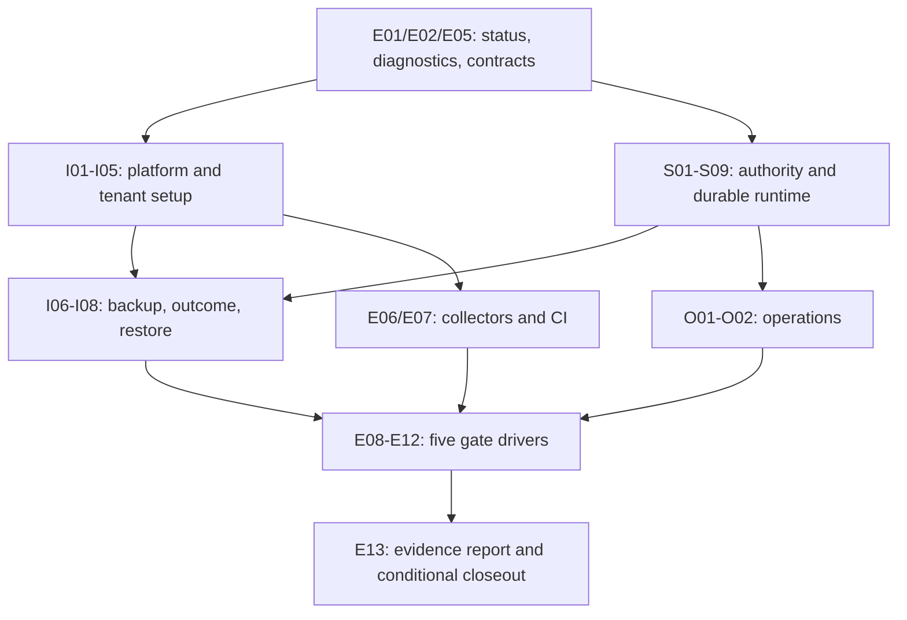

# APP-02B — Roadmap Windows Local PREPROD Acceptance

**Trạng thái:** ROADMAP_PROPOSED cho toàn bộ lab. **4/32 increments đã SOURCE_MERGED:** LAB-E01 (DOCS_ONLY) [#87](https://github.com/chung6a8m/fmcg-distribution-dotnet/pull/87), LAB-E02 [#88](https://github.com/chung6a8m/fmcg-distribution-dotnet/pull/88), LAB-E05 [#89](https://github.com/chung6a8m/fmcg-distribution-dotnet/pull/89), LAB-I01 [#90](https://github.com/chung6a8m/fmcg-distribution-dotnet/pull/90); **28 increments còn lại PLANNED**. Source merge không xác nhận laptop sẵn sàng, LAB_EXECUTED hoặc physical PREPROD.
**Baseline lập kế hoạch:** `main` [`16d96c71a7967c216ebfa599693807a2b54e7435`](https://github.com/chung6a8m/fmcg-distribution-dotnet/commit/16d96c71a7967c216ebfa599693807a2b54e7435), 19/11/2026. **Đối chiếu source đã merge:** [`89fb262c`](https://github.com/chung6a8m/fmcg-distribution-dotnet/commit/89fb262c53e3eb0186ed36bf8a5ec9ef2b77ab99), 21/11/2026; PR source và merge SHA của từng increment giữ riêng.
**Goal:** solo developer dùng Windows laptop để triển khai lab có kiểm soát, chạy scenario thật và thu evidence có thể đối chiếu; chuẩn bị các điều kiện còn thiếu cho original APP-02B physical acceptance.
**Architecture/tech stack:** Windows operator + Linux APP/DATA/VAULT VMs, Docker Compose, SQL Server, Vault, .NET 10, PowerShell/Python; [thiết kế và hợp đồng](app-02b-local-preprod/design.md).
**Global constraints:** giữ immutable business baseline, original synthetic/LocalDB/foundation guards, exact-source evidence và original B.1/B.9. Đây là roadmap triển khai, chưa phải Owner approval cho môi trường cụ thể hoặc sửa hợp đồng human review.

**Parallel Docker/WSL2 rehearsal:** The [LAB-D00–D04 roadmap](app-02b-local-docker-wsl2-rehearsal.md) and [proposed ADR](../decisions/proposed-app02b-docker-wsl2-rehearsal-2026-11-21.md) cover a Windows laptop with Docker/WSL2. D00 is the proposal, and the directly authorized D01 source is `SOURCE_REVIEW / HOST_NOT_RUN`. D02–D04 and any host Apply require separate authorization. The 32-row Hyper-V register, LAB-I01/I02 gates, M1 `LOCAL_LAB_READY` and original B.1/B.9 physical acceptance use their own evidence.

## 1. Cách dùng roadmap

Mỗi ID `LAB-*` tương ứng **một PR có trách nhiệm, interface và tiêu chí hoàn tất riêng**. “PR độc lập” nghĩa là review/merge được theo dependency đã ghi; không có nghĩa mọi PR có thể chạy trước mọi PR khác. Không gộp platform, auth, restore và oracle vào một PR lớn. Không dùng nhánh chưa merge làm dependency ngầm.

Đọc [Design](app-02b-local-preprod/design.md), chọn một dòng ở bảng dưới, mở spec tương ứng và dùng [Codex handoff](app-02b-local-preprod/codex-handoff.md). Các prefix I/S/O/E là execution tracks bổ sung; **không thay số B.1–B.9 hoặc 30 case gốc**.

| Tài liệu | Nội dung |
|---|---|
| [01 — Platform/recovery](app-02b-local-preprod/01-platform-and-recovery.md) | 8 PR: Windows, VMs, Vault/TLS, SQL, tenants, backup, outcome, PITR |
| [02 — Security/runtime](app-02b-local-preprod/02-security-and-runtime.md) | 9 PR: #53, session, keys, actor/RBAC enrollment, typed API, durable intake, Worker, CASE, audit |
| [03 — Operations](app-02b-local-preprod/03-operations.md) | 2 PR: telemetry/alert/incident, legal hold/archive/purge |
| [04 — Evidence/CI/closeout](app-02b-local-preprod/04-evidence-and-closeout.md) | 13 PR: status, #75, contracts/collectors/CI, 5 gate drivers, closeout |
| [Case matrix](app-02b-local-preprod/case-matrix.md) | Exact 30 expected symbols/negative invariants/kinds + 2 runtime probes |
| [Codex handoff](app-02b-local-preprod/codex-handoff.md) | Prompt, file ownership, commands, PR/review criteria và final-SHA protocol |

## 2. Baseline đã xác minh và hệ quả triển khai

| Record | Snapshot 21/11/2026 | Roadmap xử lý |
|---|---|---|
| [#53](https://github.com/chung6a8m/fmcg-distribution-dotnet/issues/53) / [PR #74](https://github.com/chung6a8m/fmcg-distribution-dotnet/pull/74) | Issue CLOSED on GitHub (2026-11-21; physical B53 NOT_VERIFIED); #74 OPEN/DRAFT, source `aaa32dbaff987494190e628592588317a46e3ce0`; SQL bridges chưa là end-to-end runtime/PITR verification | S01→S02/S04/S06/S07→I08→E08/E10. Source integration có disposition riêng; không cần đóng #53 để viết code kiểm tra chính nó |
| [#75](https://github.com/chung6a8m/fmcg-distribution-dotnet/issues/75) / [#68](https://github.com/chung6a8m/fmcg-distribution-dotnet/issues/68) | LocalDB bootstrap và A11-09 HTTP500 là hai nhánh điều tra; rerun PASS chưa chứng minh nguyên nhân | E02 diagnostics, E03 và E04 fix riêng theo trace |
| [#59](https://github.com/chung6a8m/fmcg-distribution-dotnet/issues/59) / [PR #61](https://github.com/chung6a8m/fmcg-distribution-dotnet/pull/61) | CLOSED / `WITHDRAWN_ADVISORY_SCOPED_RISK_ACCEPTED / NOT_PATCHED`; source/ephemeral-CI scope; hết hạn `2026-12-19T00:00:00Z` | E01 ghi scope hiện tại và giữ lỗi CI lịch sử; E07/E13 kiểm tra scope/expiry; không coi dependency đã patched |
| [PR #73](https://github.com/chung6a8m/fmcg-distribution-dotnet/pull/73) | CLOSED / SUPERSEDED / UNMERGED, source `d8564ab5274c84ad347ab26f227b3d01dd1562b6` | LAB-E01 [#87](https://github.com/chung6a8m/fmcg-distribution-dotnet/pull/87) đã thay thế hồ sơ tại cùng [đường dẫn closeout](../closeout/2026-11-18-app-02b9-source-only.md#pr-73-predecessor-disposition). Giữ review, failed CI và artifact lịch sử; không merge lại nhánh cũ |
| [#52](https://github.com/chung6a8m/fmcg-distribution-dotnet/issues/52), [#54](https://github.com/chung6a8m/fmcg-distribution-dotnet/issues/54), [#55](https://github.com/chung6a8m/fmcg-distribution-dotnet/issues/55), [#60](https://github.com/chung6a8m/fmcg-distribution-dotnet/issues/60), [#64](https://github.com/chung6a8m/fmcg-distribution-dotnet/issues/64), [#65](https://github.com/chung6a8m/fmcg-distribution-dotnet/issues/65), [#67](https://github.com/chung6a8m/fmcg-distribution-dotnet/issues/67) | Source mitigations/CI và actual environment acceptance là hai mức riêng; còn runtime/role/key/audit/source integration | I03–I05, S02–S08, O01–O02, E06/E08/E09/E11; reuse mitigation đã merge |
| [#56](https://github.com/chung6a8m/fmcg-distribution-dotnet/issues/56) | CLOSED trên GitHub; 30 physical cases `NOT_RUN / NOT_VERIFIED`, RUNTIME-01/02 `NOT_VERIFIED` | E13 chỉ đề xuất physical closeout khi toàn bộ original contract thật sự đạt |

Đối chiếu [risk policy #59](../security/issue59-conditional-risk-policy.json) trước mỗi candidate. Exception `APP00A_SYNTHETIC_CI_BUILD_TOOLS_ONLY` không tự mở frontend publication hoặc deployment. Lab này ưu tiên backend HTTP/SQL; frontend giữ trong phạm vi CI hiện được duyệt. Quyết định source-only của PR trước không tự áp dụng cho PR #74 hoặc increment mới.

## 3. Increment register — một dòng, một PR

Dependency dưới đây là **source/API prerequisite**. Live run còn cần enrolled environment, credentials, fixtures và fault scope. Trạng thái từng increment nằm ở cột State.

| ID | PR scope | Source/API dependencies | Deliverable chính | State |
|---|---|---|---|---|
| [LAB-E01](app-02b-local-preprod/04-evidence-and-closeout.md#lab-e01) | Đồng bộ #73/#59 và phạm vi lab | — | Docs/state, không close physical | SOURCE_MERGED (DOCS_ONLY) [#87](https://github.com/chung6a8m/fmcg-distribution-dotnet/pull/87) · final source [9bd8099](https://github.com/chung6a8m/fmcg-distribution-dotnet/commit/9bd8099f0ce6b0cb953cbdea7e30e6566a319709) |
| [LAB-E02](app-02b-local-preprod/04-evidence-and-closeout.md#lab-e02) | Diagnostics cho LocalDB và A11-09 | — | Artifact lỗi redacted, giữ assertion | SOURCE_MERGED [#88](https://github.com/chung6a8m/fmcg-distribution-dotnet/pull/88) · source [0c4a9a9](https://github.com/chung6a8m/fmcg-distribution-dotnet/commit/0c4a9a91a13b51cdae50208fab48c2bccafd8d60) · merge [ddc227e](https://github.com/chung6a8m/fmcg-distribution-dotnet/commit/ddc227e202a307a7a21951d7545985e036a13459); #75/#68 OPEN |
| [LAB-E03](app-02b-local-preprod/04-evidence-and-closeout.md#lab-e03) | Fix LocalDB bootstrap có root cause | LAB-E02 | Regression deterministic và bounded init | PLANNED |
| [LAB-E04](app-02b-local-preprod/04-evidence-and-closeout.md#lab-e04) | Fix HTTP 500 sau OS restart | LAB-E02 | A/B × Worker on/off regression | PLANNED |
| [LAB-E05](app-02b-local-preprod/04-evidence-and-closeout.md#lab-e05) | Run context, catalog và schema | — | 30+2 rows, append-only attempts | SOURCE_MERGED [#89](https://github.com/chung6a8m/fmcg-distribution-dotnet/pull/89) · source [f822a82](https://github.com/chung6a8m/fmcg-distribution-dotnet/commit/f822a82ad0b31f8bd8d1004e05ffcb73e306a142) · merge [2c3cd2a](https://github.com/chung6a8m/fmcg-distribution-dotnet/commit/2c3cd2a4b805746a79b4222939877a1980acdd1a); [V1 contract](app-02b-local-preprod/lab-e05-contract.md) |
| [LAB-I01](app-02b-local-preprod/01-platform-and-recovery.md#lab-i01) | Preflight Windows và toolchain | LAB-E05 | Inventory read-only, version locks | SOURCE_MERGED [#90](https://github.com/chung6a8m/fmcg-distribution-dotnet/pull/90) · source [3fa9dc9](https://github.com/chung6a8m/fmcg-distribution-dotnet/commit/3fa9dc9e8f78986e3afe75ee50d26cd8f425f606) · merge [f4f941e](https://github.com/chung6a8m/fmcg-distribution-dotnet/commit/f4f941eed616af4083ed64d25951be5bab4ac78c); host preflight BLOCKED |
| [LAB-I02](app-02b-local-preprod/01-platform-and-recovery.md#lab-i02) | VM Hyper-V và network | LAB-I01 | APP/DATA/VAULT idempotent, deny probes | PLANNED |
| [LAB-I03](app-02b-local-preprod/01-platform-and-recovery.md#lab-i03) | Vault bền, TLS và credentials | LAB-I02 | Raft/ACL/rotation/recovery | PLANNED |
| [LAB-S01](app-02b-local-preprod/02-security-and-runtime.md#lab-s01) | B53 bridges và monotonic fence | LAB-E01 | Review PR #74, transaction atomicity | PLANNED |
| [LAB-I04](app-02b-local-preprod/01-platform-and-recovery.md#lab-i04) | SQL thật và operator transport | LAB-I03, LAB-S01 | TLS, migration, least privilege | PLANNED |
| [LAB-I05](app-02b-local-preprod/01-platform-and-recovery.md#lab-i05) | Tenant lifecycle và privilege probes | LAB-I04 | A/B enrollment, B53 permit, retirement denial | PLANNED |
| [LAB-S02](app-02b-local-preprod/02-security-and-runtime.md#lab-s02) | Login/refresh/JWT durable authority | LAB-S01 | Cùng transaction với B53 | PLANNED |
| [LAB-S03](app-02b-local-preprod/02-security-and-runtime.md#lab-s03) | Key lifecycle và MFA posture | LAB-S02, LAB-I03 | Rotation/history, deny posture | PLANNED |
| [LAB-S09](app-02b-local-preprod/02-security-and-runtime.md#lab-s09) | B3 fixture actors và B5 authority enrollment | LAB-S02, LAB-I05, LAB-E05 | Approved lab accounts/RBAC, monotonic change receipts | PLANNED |
| [LAB-S04](app-02b-local-preprod/02-security-and-runtime.md#lab-s04) | Typed command executor và Lab.Api | LAB-S09, LAB-E05 | Current authority + atomic audit intent | PLANNED |
| [LAB-S05](app-02b-local-preprod/02-security-and-runtime.md#lab-s05) | Shared durable intake/source adapter | LAB-S04, LAB-I05 | Journal thật, canonical v1 giữ nguyên | PLANNED |
| [LAB-I06](app-02b-local-preprod/01-platform-and-recovery.md#lab-i06) | Backup schedule và retained copies | LAB-I05, LAB-E05 | FULL/DIFF/LOG, LSN/key/transfer receipts | PLANNED |
| [LAB-I07](app-02b-local-preprod/01-platform-and-recovery.md#lab-i07) | Durable outcome receiver | LAB-I03, LAB-E05 | Same-ID dedup, lost ACK, UNKNOWN | PLANNED |
| [LAB-S06](app-02b-local-preprod/02-security-and-runtime.md#lab-s06) | Lab.Worker trên journal APP-02A | LAB-S05, LAB-I07 | Claim/apply current authority | PLANNED |
| [LAB-S07](app-02b-local-preprod/02-security-and-runtime.md#lab-s07) | Policy/CASE với source thật | LAB-S06 | L0/L1/L2, maker/checker, same-event resume | PLANNED |
| [LAB-S08](app-02b-local-preprod/02-security-and-runtime.md#lab-s08) | Audit relay và external anchor | LAB-S04 | Atomic intent, append, tamper detection | PLANNED |
| [LAB-O01](app-02b-local-preprod/03-operations.md#lab-o01) | Telemetry, alert và incident | LAB-S06, LAB-S08, LAB-I06 | Actual receive/ACK/escalation | PLANNED |
| [LAB-E06](app-02b-local-preprod/04-evidence-and-closeout.md#lab-e06) | Collectors SQL/HTTP/network/Vault | LAB-E05, LAB-I04 | Raw-before-descriptor, full fingerprints | PLANNED |
| [LAB-I08](app-02b-local-preprod/01-platform-and-recovery.md#lab-i08) | Restore/cutover và đo safe return | LAB-I06, LAB-I07, LAB-S03, LAB-S07, LAB-S08, LAB-O01, LAB-E06 | PITR, canonical binding, RPO/RTO | PLANNED |
| [LAB-O02](app-02b-local-preprod/03-operations.md#lab-o02) | Legal hold và archive/purge | LAB-O01, LAB-S07, LAB-E06 | Archive apply, hold/purge guards | PLANNED |
| [LAB-E07](app-02b-local-preprod/04-evidence-and-closeout.md#lab-e07) | Exact-source CI inventory | LAB-E03, LAB-E04, LAB-E05 | 10 B9 checks + relevant extras | PLANNED |
| [LAB-E08](app-02b-local-preprod/04-evidence-and-closeout.md#lab-e08) | Driver G-B01 — security | LAB-S07, LAB-S08, LAB-I08, LAB-E06 | 6 cases, COMMIT races and restore | PLANNED |
| [LAB-E09](app-02b-local-preprod/04-evidence-and-closeout.md#lab-e09) | Driver G-B02 — secrets/policy | LAB-S03, LAB-S07, LAB-S08, LAB-I05, LAB-E06 | 6 cases, ACL/rotation/UNSET | PLANNED |
| [LAB-E10](app-02b-local-preprod/04-evidence-and-closeout.md#lab-e10) | Driver G-B03 — recovery | LAB-I08, LAB-E06 | 6 cases, PITR/outcome/failed restore | PLANNED |
| [LAB-E11](app-02b-local-preprod/04-evidence-and-closeout.md#lab-e11) | Driver G-B04 — operations | LAB-O02, LAB-E06, LAB-I08 | 6 cases, alert/hold/archive | PLANNED |
| [LAB-E12](app-02b-local-preprod/04-evidence-and-closeout.md#lab-e12) | Driver G-B05 — provenance/review | LAB-E07, LAB-E08, LAB-E09, LAB-E10, LAB-E11 | 6 cases, stale/fake evidence rejected | PLANNED |
| [LAB-E13](app-02b-local-preprod/04-evidence-and-closeout.md#lab-e13) | Lab report và conditional closeout | LAB-E12 | Handoff; #56 remains conditional | PLANNED |

## 4. Thứ tự triển khai thực dụng cho solo dev

**Checkpoint 21/11/2026 — bước gần nhất.** E01/E02/E05/I01 đã merge source. Lượt Windows I01 được ghi trong #90 trên source ban đầu `22e70256b99a759bd8c27d296206c0a41960da49` là `HOST_PREFLIGHT_OBSERVED / BLOCKED` (exit 2), chưa có report host PASS trên final source được dẫn ở đây. Chạy lại I01 từ checkout sạch của source đã merge, giữ JSON/Markdown và xử lý từng FAIL/UNKNOWN theo reason code. Sau đó triển khai LAB-I02 theo [spec](app-02b-local-preprod/01-platform-and-recovery.md#lab-i02); source PR có thể chuẩn bị từ I01 đã merge, còn live Apply cần host readiness và phạm vi môi trường/đích đã duyệt. Tiếp I03–I05 để hướng tới LOCAL_LAB_READY; chỉ I01 hoặc I02 chưa đạt milestone đó.

**Đợt 1 — phần còn lại.** E03/E04 điều tra riêng LocalDB bootstrap và A11-09 theo diagnostics E02. Chưa chứng minh root cause thì giữ INVESTIGATION_BLOCKED có evidence thiếu cụ thể; #75/#68 không được đóng chỉ vì rerun xanh. E05 đã chốt contract source; collectors, scenario execution và original physical acceptance vẫn là các bước sau.

**Đợt 2 — dựng lab và đường authority.** I02→I03, review S01/#74, rồi I04→I05. Song song theo dependency: S02→S03, (S02 + I05 + E05)→S09→S04; I06/I07; E06. S09 bổ sung account/membership/RBAC lifecycle có phê duyệt; không dùng CI seed làm live authority. S04 giữ các host foundation hiện tại và tạo host lab riêng, có approved source/config/operation manifest.

**Đợt 3 — end-to-end runtime và recovery.** S05→S06→S07; S08 có thể bắt đầu ngay sau S04. O01 nối telemetry/alert thật; I08 triển khai cutover và safe return; O02 làm retention mechanism. Đừng chạy full gate trước khi API→journal→Worker→CASE→outcome/audit có đường thực thi thật.

**Đợt 4 — evidence và closeout.** E07 xác minh đúng check inventory; E08–E11 có thể làm độc lập sau prerequisite của từng gate; E12 tổng hợp provenance; E13 freeze source, chạy toàn bộ selection, giữ gaps và chuẩn bị actual physical handoff nếu đủ điều kiện.

Đối với một người, giữ **một PR implementation chính đang làm**; dùng agent/context riêng để review và chuẩn bị test/spec của PR kế tiếp. Không dùng nhiều agent sửa chung schema/contract chưa ổn định. Không ước lượng ngày cố định trước I01, E02 và source review #74: năng lực máy và root cause hiện chưa được chứng minh.

Diagram là phase summary; bảng dependency và từng spec là nguồn chính xác.

## 5. Các quyết định kỹ thuật đã chốt trong thiết kế đề xuất

1. **Windows điều khiển; Linux chạy stack.** APP, DATA, VAULT là ba VM; observer ở Windows hoặc VM thứ tư. Các VM vẫn chung failure domain/custodian của laptop. Hyper-V eligibility, CPU, RAM, disk và NAT phải được preflight xác minh.
2. **B3/B4/B5, B6 policy và tenant effect cùng SQL instance.** Current fence cần một SqlConnection/SqlTransaction. Không chuyển một DB sang instance khác hoặc grant sysadmin để chữa permission lỗi. B5/Vault/outcome journal không bị rewind cùng tenant.
3. **Foundation guards giữ nguyên; lab có host và typed kernel riêng.** Không mở lại generic arbitrary-SQL callback hoặc synthetic HTTP guard. S05/S06 reuse durable APP02 journal/canonicalization; explicit unitless fixture scope cần được duyệt trước mutation.
4. **Evidence có provenance và raw độc lập với application assertion.** Run context bind source/config/fixture/host; raw capture trước witness descriptor; append attempt history; full-table fingerprints; no-read dưới workload identity; snapshots/CI responses không thay original receipts.
5. **Restore là quy trình nhiều bước có thể dừng an toàn.** I08 owns staged restore → canonical cutover → Registry/B5 CAS → verification → fresh activation request. RTO kết thúc ở safe API và Worker return, không ở SQL ONLINE. UNKNOWN external outcome giữ HOLD/CASE.
6. **Source merge, lab verification, physical acceptance là ba trạng thái riêng.** Solo role separation có ích cho kỹ thuật; B05-02 vẫn BLOCKED nếu không có independent humans theo original contract.

## 6. Milestones và Definition of Done

| Milestone | Hoàn tất khi | Nhãn/phạm vi tối đa |
|---|---|---|
| M0 — planning | Design, 32 dependency-scoped PR specs, exact case map, handoff và docs review | ROADMAP_PROPOSED; chưa triển khai |
| M1 — reproducible lab | I01–I05 đạt live setup checks trên đúng laptop; scope/credentials/targets enrolled | LOCAL_LAB_READY; chưa gate acceptance |
| M2 — real execution path | S01–S09, O01–O02, I06–I08 có source/relevant CI và lab positive/negative measurements | LOCAL mechanism evidence với gaps cụ thể |
| M3 — full coverage report | E05–E13 thu đủ 30+2 rows, actual attempts/CI; FAIL/BLOCKED không bị che | LOCAL_OPERATOR_LAB_TESTED chỉ cho phần thực sự đo; SOLO_OWNER_SELF_ATTESTED |
| M4 — original physical closeout | Original all30/all5 + runtime2, approved external trust, actual witnesses/reviewers, recovery/off-host custody, exact-source CI và Owner disposition | Có thể đề xuất PREPROD_FOUNDATION_VERIFIED cho #56; không tự mở production/Pilot |

Một code PR chỉ gọi SOURCE_READY/SOURCE_MERGED khi: phạm vi đúng increment; regression chứng minh invariant; relevant retained CI đúng HEAD; independent technical review không còn blocker; migration/config/admission defaults an toàn; PR body ghi live tests đã chạy/chưa chạy. Thiếu applicable source-merge disposition thì giữ Draft có lý do, không thừa kế exception cũ.

Trạng thái register: `PLANNED → IN_PROGRESS → SOURCE_REVIEW → SOURCE_MERGED → LAB_EXECUTED → LAB_REVIEWED`; BLOCKED luôn kèm dependency/artifact/reason. Ghi source/CI, quan sát laptop và original physical ledger ở các dòng riêng; host preflight BLOCKED không phải LAB_EXECUTED hay LOCAL_LAB_READY. Original physical ledger giữ riêng NOT_RUN/NOT_VERIFIED. Một docs PR hoàn tất không chuyển 32 implementation rows thành done. Closeout gắn với increment có thay đổi source/evidence/status thực chất theo [quy ước handoff](app-02b-local-preprod/codex-handoff.md#51-increment-closeout), không tạo chuỗi PR chỉ xác nhận merge của closeout trước.

## 7. Điều kiện trước khi xác nhận physical acceptance của #56

- E01 đã đồng bộ tài liệu B.9/#73 với #59; mọi scope/expiry hiện tại được kiểm tra lại.
- #53 có end-to-end current authority, actual restore và Worker/CASE witnesses; #75 có root-cause disposition của cả hai nhánh, không chỉ một green rerun.
- Frozen source H, fixture, image digests, migrations và effective config khớp evidence/CI/review; mọi source thay đổi phải revalidate.
- 30 original cases, 5 gates và 2 runtime probes đầy đủ actual witnesses; required CI không missing/skipped; original B9 mutations vẫn reject.
- Independent observer/Security/DBA và key custody đáp ứng đúng original contract; actual approved retention/restore/outcome/alert evidence đầy đủ.
- Nếu chỉ có một người: hoàn thành báo cáo local trung thực, giữ các điều kiện chưa đạt BLOCKED, kể cả khi GitHub #56 hiển thị CLOSED. Một alternative solo contract chỉ tồn tại sau explicit versioned Owner disposition riêng; roadmap này không ban hành ngoại lệ đó.

Xem [original B.1 case contract](../security/app-02b1-acceptance-evidence.md), [original B.9](app-02b9-independent-preprod-oracle.md) và [Owner decisions](../decisions/owner-app02b-2026-11-17.md). APP-02C/D/E, production/Pilot/Go-Live, real EV-08 và production P0 không được đóng bởi roadmap hoặc local lab này.
