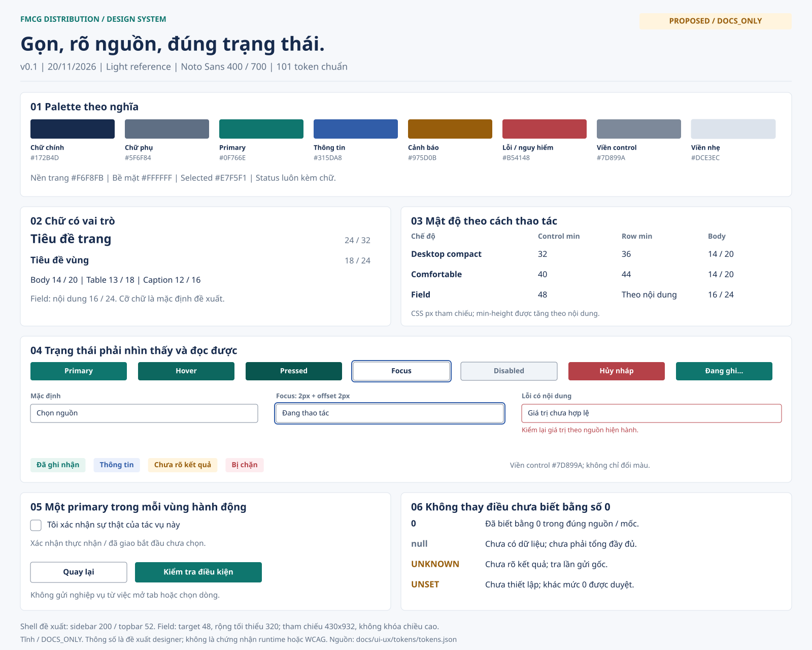

# FMCG UI/UX Standard v0.1

**Hướng triển khai hiện tại (24/11/2026):** [APP-03 — ứng dụng DEV tích hợp](../roadmap/app-03.md) đã được Owner đồng ý và có [bằng chứng nghiệm thu synthetic DEV APP-03.9](../roadmap/app-03-9-acceptance.md). UI Sales A của C.1–C.5 và C.6 đã có bằng chứng DEV; các màn D/F tiếp tục có phạm vi riêng theo [APP-02](../roadmap/app-02.md). UI-05 được ánh xạ vào APP-03.3–.8: phiên/khung chung, bàn giao công việc và Owner report trên cùng dữ liệu. Mỗi màn có một increment chủ trì, giữ phân nhiệm server và dùng lại UI đã có. Các PR triển khai dùng roadmap APP-03, không cần chờ hồ sơ vận hành thực tế hoặc lặp lại xác nhận cùng phạm vi DEV. [Nợ operations/acceptance](../roadmap/app-02c-operations-debt.md) và physical PREPROD/EV/P0 giữ mốc riêng.

**Design Baseline v0.1 `ADOPTED`** qua [PR #79](https://github.com/chung6a8m/fmcg-distribution-dotnet/pull/79), merge commit `71ff1c28890dd45724b71d0140a23ac2810417a1`. Owner duyệt 9/9 ngày 20/11/2026. [Biên bản OWN-UX-01..09](../decisions/owner-uiux-2026-11-20.md).

Bộ quy chuẩn chuyển ngôn ngữ thiết kế của năm bộ prototype thành tài liệu có thể dùng khi đặc tả, triển khai và review UI của `fmcg-distribution-dotnet`. Hướng đã được người dùng yêu cầu là **gọn, nhiều dữ liệu hữu ích trên cùng màn hình**, bao phủ Sales A, Kho/điều phối, Hiện trường, Thủ quỹ/kế toán và Chủ NPP/vận hành.

Owner chọn teal/navy, Noto Sans self-hosted, Desktop Compact, Field-first, Light/Dark/System, adaptive list/detail và chiến lược library theo ADR. UI-01 foundations/demo đã `MERGED / CI_VERIFIED` (synthetic/nonproduction) qua [PR #80](https://github.com/chung6a8m/fmcg-distribution-dotnet/pull/80); [closeout UI-01](../closeout/2026-11-20-ui-01.md). UI-02 form/identity lookup/editable grid tại `/ui/data-entry` đã `MERGED / UI02_100_PERCENT_CI_VERIFIED` (synthetic/nonproduction, zoom 100%) qua [PR #82](https://github.com/chung6a8m/fmcg-distribution-dotnet/pull/82); [closeout UI-02](../closeout/2026-11-20-ui-02.md). UI-03 `/ui/command-recovery` đã **`MERGED / UI03_100_PERCENT_CI_VERIFIED`** trong phạm vi `SYNTHETIC_NONPRODUCTION / 100_PERCENT_BROWSER_CI_ONLY` qua [PR #84](https://github.com/chung6a8m/fmcg-distribution-dotnet/pull/84). Final reviewed source `dcd2870`, merge `f17397e`, 10/10 workflows/20/20 jobs SUCCESS, 51/51 Playwright PASS; [post-merge closeout UI-03](../closeout/2026-11-20-ui-03.md) · [ủy quyền riêng](../decisions/owner-ui03-2026-11-20.md) · [spec/ADR](ui-03-source-command-recovery.md) · [verification](ui-03-verification.md). [PR #86](https://github.com/chung6a8m/fmcg-distribution-dotnet/pull/86) UI-04 vẫn OPEN / DOCS_ONLY, là readiness candidate cần rebase/đối chiếu với hướng C DEV; không là prerequisite của C.1 hoặc implementation đã merge. UI-05 theo [roadmap APP-03 đã duyệt](../roadmap/app-03.md), các workspace liên vai có bằng chứng synthetic DEV trong APP-03.3–.9. [Sổ quyết định](decisions.md).

## Đọc và áp dụng

| Tài liệu | Dùng khi nào |
|---|---|
| [Tailwind v4 và Light/Dark](tailwind-v4-and-themes.md) | Adapter CSS-first, theme selection, portal/native controls và giới hạn kiểm chứng |
| [Foundations](foundations.md) | Màu, chữ, khoảng cách, mật độ, shell và semantic tokens |
| [Component contracts](components.md) | Cấu trúc và trạng thái thành phần dùng chung |
| [Interaction patterns](interaction-patterns.md) | Bàn phím, bảng, lookup, form, focus và cập nhật dữ liệu |
| [Business UX patterns](business-patterns.md) | Nguồn, phạm vi, tiền/hàng, quyền, approval, UNKNOWN và kết chuyến |
| [Accessibility và responsive](accessibility-and-responsive.md) | Contrast, keyboard, vùng chạm, màn nhỏ và phạm vi nghiệm thu |
| [Nội dung và định dạng](content-and-formatting.md) | Tiếng Việt, số, tiền, đơn vị, thời gian và microcopy |
| [Quản trị và review](governance-and-review.md) | MUST/SHOULD, ngoại lệ, phiên bản và bằng chứng PR |
| [Mapping prototype](prototype-mapping.md) | Truy nguồn 52 bản màn hình và các điểm đã chuẩn hóa |
| [Sổ quyết định](decisions.md) / [Owner Decisions](../decisions/owner-uiux-2026-11-20.md) | 9 quyết định đã chốt, các mục còn mở và giới hạn cấp quyền |
| [Kiểm tra reference UI-00](verification.md) / [Kiểm chứng runtime UI-01](ui-01-verification.md) / [UI-02 component ADR](ui-02-data-entry.md) / [UI-02 verification](ui-02-verification.md) / [UI-03 command ADR](ui-03-source-command-recovery.md) / [UI-03 verification](ui-03-verification.md) | Compiler/token parity và evidence runtime theo source HEAD của từng PR |
| [Closeout UI-01](../closeout/2026-11-20-ui-01.md) / [UI-02](../closeout/2026-11-20-ui-02.md) / [UI-03](../closeout/2026-11-20-ui-03.md) | Source/merge identity, review findings, CI và phạm vi chưa kiểm chứng |
| [Adoption roadmap](adoption-roadmap.md) / [APP-03](../roadmap/app-03.md) | Trạng thái từng increment, phạm vi đã được Owner duyệt và ánh xạ UI-05 vào APP-03 |
| [Screen spec template](templates/screen-spec.md) | Đặc tả một màn hình/luồng trước khi code |
| [Component spec template](templates/component-spec.md) | Đặc tả thành phần trước khi tạo hoặc mở rộng |
| [Tokens JSON](tokens/tokens.json) / [CSS](tokens/tokens.css) / [Tailwind v4 adapter](tokens/tailwind-v4.css) | Token và adapter dùng trực tiếp trong CSS của UI-01 |
| [Bảng tham chiếu thị giác](assets/design-system-sheet.svg) | Review nhanh palette, typography, density và trạng thái |

## Thứ tự ưu tiên khi có khác biệt

1. Chỉ dẫn và quyết định Owner có hiệu lực trong đúng phạm vi; không suy quyền từ một ngoại lệ của increment khác.
2. Hợp đồng nghiệp vụ/API được phê duyệt, `business/` đã khóa và các quyết định/module contracts hiện hành. Nếu chúng mâu thuẫn, ghi blocker để giải quyết; không tự chọn cách dễ dựng UI hơn.
3. Bản UI/UX Standard đã được chấp nhận và screen/component spec của increment.
4. Prototype và fixture minh họa. Screenshot giúp hiểu bố cục; không là API schema, policy, máy trạng thái hoặc evidence runtime.

Trong baseline đã được áp dụng, **MUST** là yêu cầu trong phạm vi liên quan và **SHOULD** là mặc định có thể có ngoại lệ được ghi rõ. Business/security contracts hiện hành vẫn có thẩm quyền cao hơn. [Governance](governance-and-review.md) quy định versioning và exception.

## Nguyên tắc thiết kế

- **Đọc nhanh và truy được nguồn:** giá trị quan trọng có tên, đơn vị, phạm vi, mốc dữ liệu và đường mở chi tiết.
- **Gọn theo công việc:** giảm phần lặp và chuyển màn, giữ thông tin cần so sánh; chiều cao dòng được tăng khi nội dung cần.
- **Một ngữ cảnh, một ưu tiên hành động:** người dùng biết thao tác nào đang thực hiện và bước nào tiếp theo.
- **Trạng thái đúng nghĩa:** thiếu dữ liệu, bằng 0, đang xử lý, bị từ chối và chưa rõ kết quả có cách trình bày riêng.
- **Bàn phím và chạm có hợp đồng riêng:** desktop thao tác bảng; Field dùng bố cục một cột và vùng chạm rộng.
- **Phục hồi giữ liên kết nghiệp vụ:** tra lại yêu cầu gốc khi chưa rõ kết quả; mọi ghi nhận dựa trên kết quả có thẩm quyền.

## Phạm vi kỹ thuật hiện tại

Health/PWA shell tại `/`, UI-01 `/ui/foundations`, synthetic UI-02 `/ui/data-entry` và synthetic UI-03 `/ui/command-recovery` dùng chung [CSS entry](../../web/src/style.css), Noto Sans WOFF2 self-hosted 400/700, token Light và 29 Dark overrides. Bootstrap [theme-runtime.js](../../web/public/theme-runtime.js) resolve trước React; selector trong shell, demo và native dialog dùng cùng controller. [Đặc tả UI-01](ui-01-runtime-foundations.md) · [Kiểm chứng](ui-01-verification.md).

OWN-UX-07 chốt Sidebar + Adaptive List/Detail; OWN-UX-08 chốt **ADR theo từng increment** chứ chưa chọn thư viện component/grid/icon/docking cụ thể. OWN-UX-09 **chỉ** cho phép UI-01 foundations/demo controls. [Lệnh trực tiếp của Owner ngày 20/11/2026](../decisions/owner-ui02-2026-11-20.md) mở riêng UI-02 synthetic Lab với native ADR, không cho phép API nghiệp vụ, production grid hoặc UI-03…05; UI-02 đã được independent technical review và CI trên exact final source HEAD; [bằng chứng và bốn findings đã xử lý](../closeout/2026-11-20-ui-02.md). UI-02 không tự cấp quyền UI-03; UI-03 được Owner ủy quyền riêng cho synthetic Lab và đã merge qua [PR #84](https://github.com/chung6a8m/fmcg-distribution-dotnet/pull/84), với [closeout riêng](../closeout/2026-11-20-ui-03.md). Các ủy quyền UI-01..03 không tự mở scope tiếp theo; UI Sales A trong C.1–C.5 dùng quyết định DEV riêng ngày 22/11/2026. Ngày 23/11/2026 Owner đồng ý [roadmap APP-03](../roadmap/app-03.md), bao gồm phạm vi UI-05 tích hợp synthetic DEV theo từng increment; ghi roadmap chưa phải triển khai/nghiệm thu. Production và các khả năng ngoài phạm vi đó giữ quyết định riêng.

## Giới hạn bằng chứng

PR #78 đã bàn giao tài liệu, tokens tham chiếu và bằng chứng render UI-00. Việc phê duyệt Design Baseline đơn thuần không chứng minh runtime acceptance; UI-01, UI-02 và UI-03 sau đó đều có kiểm chứng CI trên source HEAD riêng, giới hạn cho foundations/demo, form/lookup/grid và source/command recovery synthetic; không xác nhận usability/accessibility toàn sản phẩm hay E2E nghiệp vụ. Không nâng trạng thái APP/PREPROD/EV/P0, không sửa `business/` hoặc `business.lock.json`, và không mở offline business writes.

Ngoại lệ [OWN-APP00B-13-02](../decisions/owner-app00b-13-02-125-scale-exception.md) về 125% tiếp tục có hiệu lực trong phạm vi được ghi. Chuẩn này không đưa lại kiểm tra 125% thành gate bắt buộc hoặc backlog bắt buộc của APP-00B/C.
